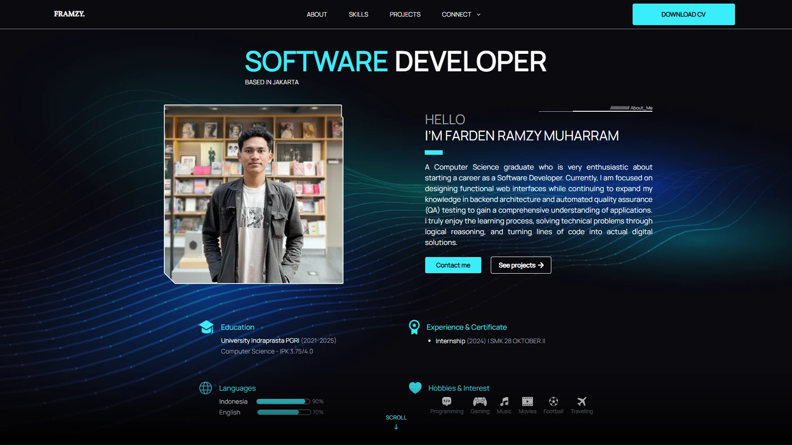

# Framzy Profile — Personal Portfolio

A personal portfolio website built to showcase my profile, technical skills, and development projects.

The website serves as a central place to explore my background, technologies I work with, and projects I have developed.

## Overview



## Features

- **About** — Introduction and personal background.
- **Skills** — Overview of technical skills, including:
  - Programming Languages
  - Databases
  - Operating Systems
  - Cloud Computing
- **Projects** — A collection of personal and academic projects, including:
  - Contact Management
  - Kedai Takjil
  - Tic Tac Toe
  - Valorant Prediction
  - Posyandu Thesis
  - School Library
- **Connect** — Links to my professional and social profiles:
  - GitHub
  - LinkedIn
  - Instagram

## Tech Stack

- React
- TypeScript
- Vite
- Tailwind CSS
- React Router

## Getting Started

### Prerequisites

Make sure you have installed:

- Node.js
- npm

### Installation

1. Clone this repository:

   ```bash
   git clone YOUR_GITHUB_REPOSITORY_URL
   ```

2. Navigate to the project directory:

   ```bash
   cd YOUR_PROJECT_DIRECTORY
   ```

3. Install dependencies:

   ```bash
   npm install
   ```

4. Start the development server:

   ```bash
   npm run dev
   ```

5. Open the local URL provided by Vite in your browser.

## Available Scripts

| Command           | Description                          |
| ----------------- | ------------------------------------ |
| `npm run dev`     | Start the development server         |
| `npm run build`   | Build the application for production |
| `npm run preview` | Preview the production build         |
| `npm run lint`    | Run ESLint                           |

## Project Structure

```text
src/
├── components/
├── features/
│   ├── about/
│   ├── skills/
│   ├── projects/
│   └── connect/
├── hooks/
├── pages/
├── types/
└── ...
```

## Author

**Framzy**

- GitHub: [Github](https://github.com/Framzy)
- LinkedIn: [LinkedIn](https://www.linkedin.com/in/farden-ramzy-muharram)
- Instagram: [Instagram](https://www.instagram.com/framzy23_/)
